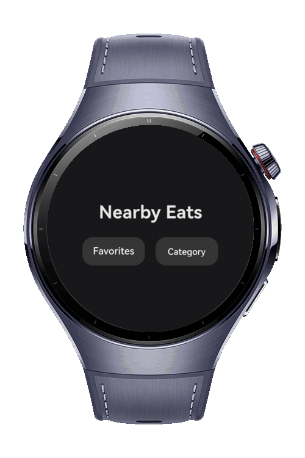
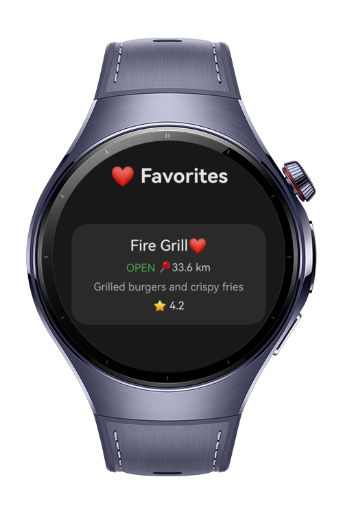

> **Note:** To access all shared projects, get information about environment setup, and view other guides, please visit [Explore-In-HMOS Index](https://github.com/Explore-In-HMOS/hmos-index).

# Nearby Eats

This is a wearable application developed with ArkTS that allows users to browse restaurants by category, view detailed information, calculate distance based on current location, and manage favorite restaurants. The app is optimized for wearable devices and focuses on fast interaction, clear UI, and persistent favorites.

# Preview

<div>
  
  
</div>

# Use Cases

- **Category Browsing:** View restaurants grouped by categories such as Cafe, Fast Food, Dessert, and Street Food.
- **Restaurant Listing:** Display restaurant cards with name, rating, open/closed status, and distance.
- **Favorites Management:** Mark or unmark restaurants as favorites using a heart icon.
- **Persistent Favorites:** Favorite restaurants are stored locally and restored when reopening the app.
- **Location Awareness:** Calculate and display distance to each restaurant using live GPS data.
- **Detail Navigation:** Navigate to a restaurant detail page by tapping on a restaurant card.
- **Wearable Optimized UI:** Simple, readable layout designed for small wearable screens.

# Technology
## Stack
- **Languages**: ArkTS
- **UI**: ArkUI
- **Frameworks**: HarmonyOS 6.0.0
- **Tools**: DevEco Studio 6.x
- **Libraries**:
    - `@kit.ArkUI`
    - `@kit.AbilityKit`
    - `@kit.LocationKit`
    - `@ohos.data.preferences`

## Required Permissions

- `ohos.permission.LOCATION`
- `ohos.permission.APPROXIMATELY_LOCATION`

# Directory Structure

```
entry/
├── src/main/
│
├── src/main/ets/
│ ├── utils/
│ │ ├── LocationUtils.ets
│ │ └── FavoritesStore.ets
│ │
│ ├── entryability/
│ │ └── EntryAbility.ets
│ │
│ ├── pages/
│ │ ├── RestaurantPage.ets
│ │ ├── RestaurantDetailPage.ets
│ │ ├── Index.ets
│ │ ├── FavoritesPage.ets
│ │ └── CategoryPage.ets
```

# Constraints and Restrictions
## Supported Device

- Huawei Watch series (Wearable devices running HarmonyOS)

# License

**Nearby Eats** is distributed under the terms of the MIT License.

See the [LICENSE](./LICENSE) for more information.